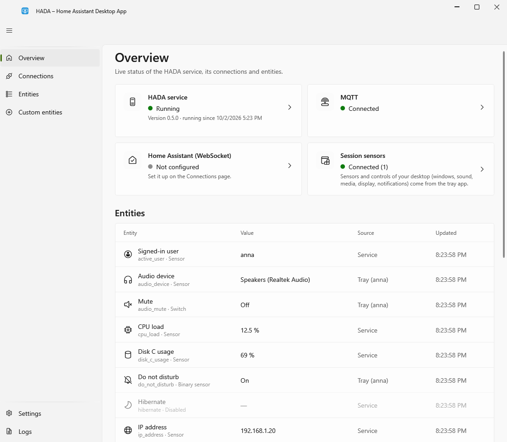

# The HADA window

Open it by double-clicking the HADA tray icon, or choose **Open HADA** from its menu. Starting `HADA.Tray.exe` again while it is already running also brings the window up. The window follows the Windows light or dark theme, and shows Polish text when Windows' display language is Polish, English otherwise, unless you choose a language on the **Settings** page.

| Page | What it shows |
|---|---|
| **Overview** | Whether the service is running, the state of both connections and whether the tray is connected, a notice when a newer version is available, and every entity with its latest value. Each status card is a button: the service's opens **Logs**, the connections' open their settings on **Connections**, the tray's opens **Entities** |
| **Connections** | MQTT and Home Assistant settings, each with a **Test connection** button |
| **Entities** | A switch per entity to choose what is shared with Home Assistant and what Home Assistant may do. Disabled entities are removed from Home Assistant. The power buttons start switched off |
| **Custom entities** | Your own sensors (a fixed text, whether a program is running or a device is connected, the output of a PowerShell command), buttons (run a PowerShell command, start a program, press keys) and [quick actions](features/custom-entities.md#quick-actions) |
| **Settings** | [Updates](getting-started/updating.md): the installed version, **Check now**, and whether to check by itself and for test versions too (*not released yet:* these need no administrator rights either). And settings of your own, which need no administrator rights: **Start with Windows**, the language of the window (Polish, English, or as Windows), the address of the [dashboard window](#the-dashboard-window), how long without input until `user_active` turns off, the browser that the addresses of [notifications](features/notifications.md#more-than-a-text) open in, and the **New window (preview)** switch described [below](#two-windows) |
| **Logs** | Recent service log entries, filterable by level, with copy to clipboard |

**Changing settings requires administrator rights.** Anyone signed in can see status and logs, but the pages are read-only until you choose **Unlock editing**. That reopens the window as administrator (a UAC prompt). The service checks this itself, so a non-elevated client cannot save settings or run connection tests. The **Settings** page needs no unlocking (*not released yet*: before, its two update switches did).

Your own settings on the **Settings** page can be changed in the administrator window too, as long as it runs as your account (*not released yet*: before, they were read-only there). It does when you are an administrator and only confirm the prompt. When a standard user types an administrator's name and password instead, the window runs as that administrator, and these settings stay read-only in it: changed there, they would be that account's, not yours.

Saved settings take effect immediately: the affected connection restarts. Passwords and tokens are never shown again. Leave the field empty to keep the saved value, or tick **Remove the saved value** to clear it.

## Two windows

*New in 1.7.0; the tray icon opens it since 1.8.0.*

HADA has two windows with the same pages and the same settings. **The new window** is drawn with Avalonia, is the same on Windows, Linux and macOS, and is what the tray icon opens. **The previous window** is the one the screenshots on these pages show; it stays for as long as both come with HADA. On Windows you choose between them with **New window (preview)** on the **Settings** page: turn it off, and the tray icon opens the previous one. The new window is also **HADA (new window, preview)** in the Start menu, and **New window (preview).cmd** in a [portable copy](getting-started/portable.md).

The pages are the same; what differs is the layout of two of them:

- **Overview** has a card for each way of connecting that you use, MQTT or directly, with a row for each server and its state. A notice says when a connection needs attention; close it, and it comes back with the next problem. **Manage** leads to the **Connections** page, and a server's row to that server.
- **Connections** lists your servers by the way they connect. A server opens with its state and all of its settings, to test, change or remove. **Add a connection** takes three steps: the way to connect, with what each gives and needs; the address and signing in; and a check that saves the connection and says what it does now.

The sidebar can be folded to its icons, and stays so. **Unlock editing** opens the window as administrator at the page you were on. Closing the window does not stop HADA: the first time, the window says so and where to find the icon again.

## The tray icon's menu

Right-click the HADA icon in the notification area:

- your [quick actions](features/custom-entities.md#quick-actions), if you defined any
- **Open HADA**, which a double-click on the icon does as well
- **Home Assistant dashboard**, or one **Dashboard** entry per Home Assistant when there are several; see [below](#the-dashboard-window)
- **Exit**, which stops the tray app and with it the session sensors and controls; the service keeps running

## The dashboard window

*New in 1.1.0.*

Enter an address on the **Settings** page, under **Home Assistant dashboard**, for example `http://homeassistant.local:8123/lovelace/desk`. The tray icon's menu then offers **Home Assistant dashboard**: a small window near the notification area showing that address.

*New in 1.5.0:* every Home Assistant that HADA connects to directly has a dashboard there by itself, at the address of the connection. On the **Settings** page each has a switch, for the ones you do not want in the menu, and a box for an address of your own, a particular dashboard for instance; left empty, the connection's address is shown. **Another address** is for a Home Assistant connected through MQTT, whose address HADA does not know, or for any other page.

With one dashboard the menu says **Home Assistant dashboard**; with several, each is listed by the name of its Home Assistant. There is one window: choosing another dashboard has it show that one.

It is a browser of its own, built on the Microsoft Edge WebView2 Runtime that Windows 11 includes and Windows 10 usually has. You sign in to Home Assistant in it once; the sign-in is kept in your user profile, under `%LocalAppData%\HADA\dashboard`. Like the HADA window it is a separate process that exists only while it is open.

## Memory use

Measured on Windows 11 ARM64 (private memory), with the previous window:

| Process | Memory |
|---|---|
| Service | about 15 MB |
| Tray app | 20 to 25 MB |
| Settings window, while it is open | about 125 MB |

The previous window draws with the CPU instead of the graphics card. On some graphics drivers, setting up hardware rendering alone takes more than 200 MB, and these pages have nothing that needs it.
